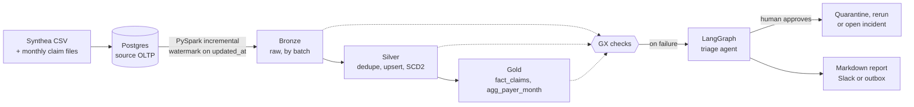

# Claims pipeline with an AI incident-triage agent

An incremental healthcare claims pipeline with quality gates at every layer. When a gate fails, a
LangGraph agent investigates the failure, classifies the root cause, proposes one fix for a human
to approve, carries it out, and writes the incident report.

It runs entirely on one laptop, using synthetic [Synthea](https://github.com/synthetichealth/synthea)
data: about 5,700 patients and 595,000 claims.



Airflow runs each stage as its own task, so a failed run shows exactly which gate tripped.

## Results

The demo injects each failure and asserts the outcome, so a wrong result stops the run.
Reports from the run are in [docs/sample_reports/](docs/sample_reports/).

| Injected failure | How it surfaces | Agent's evidence | Action | Outcome |
|---|---|---|---|---|
| `payer_id` renamed to `payer_ref` | Delta `DELTA_METADATA_MISMATCH` crash in extract | 10 of 10 values shared with `payer_id`, same column position | Open incident | 3,745 rows held, then loaded once upstream reverted |
| 20% of `payer_id` blanked | Null-rate check | 19.6% against a 0.0% baseline, all from one file | Quarantine | 694 rows held, 2,840 loaded; the sender's resend restored the rest |
| Same file loaded twice | Duplicate check | 3,609 rows already in Silver, identical sha256 in `etl.ingest_log` | Quarantine | Gold unchanged |
| Expected file missing | Row-count check | Zero new rows, last file on record | Rerun | Late file loaded on approval |

After all of them, Gold reconciles to the source exactly, on both row count and total charges.

## Run it

Needs macOS on Apple Silicon, about 10 GB of free disk, and a Python 3.12 interpreter. Docker, sudo
and API keys are not required.

```bash
scripts/run_all.sh     # toolchain, Postgres, Synthea, Airflow, then the full demo
```

The first run downloads roughly 1 GB. To work through it by hand:

```bash
source scripts/env.sh
scripts/pg.sh start
python demo/inject.py rename-column          # break something
python -m claims.pipeline.run                # the pipeline fails and writes a failure artifact
python -m claims.agent.cli start             # the agent diagnoses, then stops for approval
python -m claims.agent.cli approve <failure_id>
scripts/airflow.sh standalone                # Airflow UI on localhost:8080
python -m pytest tests -q
```

Undo the first step with `python demo/inject.py revert-column`, or reset everything with
`python -m claims.seed`.

### Using a real LLM

The agent runs without a key on `OfflinePlanner`, a deterministic chat model that drives the same
graph and tools using fixed rules. To use a real model, copy `.env.example` to `.env` and set:

```bash
TRIAGE_MODEL=google_genai:<gemini-model>     # or openai:<openai-model>
GOOGLE_API_KEY=...                           # or OPENAI_API_KEY
SLACK_WEBHOOK_URL=...                        # optional; reports go to runs/outbox/ otherwise
```

## Design decisions

**The agent can't change data on its own.** Its four tools are read-only, and `query_postgres`
connects as a role that has only SELECT, so a write hidden inside a CTE still fails. Each action
needs human approval, and its target comes from the failure artifact rather than model output.
The model picks from a fixed list and can't choose a different batch or predicate. A low-confidence
diagnosis always becomes an incident. An approval is refused if its batch has since closed.

**Approval survives a restart.** The graph checkpoints to SQLite and stops at the approval step, so
the process can exit and someone can approve hours later from another shell.

**Each check defines its own bad rows.** Every row-level check carries the same rule as a Spark SQL
predicate, so the agent samples and quarantines exactly what the check rejected.

**Failed batches stay open.** Watermarks move only after every gate passes, in one Postgres
transaction. A failed batch keeps its ID and a rerun replaces its Bronze partition, which is why
reruns can't duplicate data.

**Duplicates are detected by content.** A row is a duplicate when its business-column hash is
already in Silver, so a real correction with the same `claim_id` still gets through. A single batch
can't reveal a double load, because each reloaded row looks unique within it.

**Bronze refuses schema evolution.** With `mergeSchema` on, a renamed column would silently appear
as a new column while the old one went null. Here it crashes instead, which the agent can diagnose.

**A failed pipeline can't look green.** Airflow derives run state from leaf tasks, so a successful
triage task as the only leaf marked failed runs `success`. An explicit `finished` task prevents
that. The demo found this bug.

### Data findings that changed the model

- Synthea has no `payer_id`, and `PRIMARYPATIENTINSURANCEID` is 7.3% blank. Those blanks are all
  uninsured claims, so `payer_id` falls back to the encounter's payer. That gives a true 0% null
  baseline, which makes a real spike unmistakable.
- Each encounter has about two claims, so taking cost from `encounters` would double-count it.
  Amounts are rolled up from `claims_transactions` instead.
- Summing every payment makes paid equal charged for every payer, so a paid ratio tells you nothing.
  Payment method splits insurer from patient money: `ECHECK` is the insurer, and the rest is the
  patient. `NO_INSURANCE` now comes to exactly 0, Medicare about 0.97 and commercial plans 0.6 to 0.8.

## Differences from the original brief

| Brief | Built | Why |
|---|---|---|
| ~100k patients | 5,677 (`SYNTHEA_PATIENTS` to change) | 100k means about 2 hours of generation and 10M+ claims, too much for 2 GB of Spark driver on an 8 GB laptop. Scaling up hasn't been tested. |
| Postgres and Airflow in Docker | Native user-space installs | Docker wasn't available, and native uses less memory on 8 GB. |
| Gemini or OpenAI | Both supported, offline planner by default | No API key was available. See limitations. |
| Slack or email | Slack webhook, local outbox fallback | No webhook was available; only the outbox has been exercised. |
| 3 injected failures | 4 | Added upstream delay so all four root causes get tested. |

## Limitations

- **No real LLM has run this agent.** The demo's diagnoses come from `OfflinePlanner`, whose rules
  demonstrate the plumbing, not reasoning. The tool-calling flow was tested with the real OpenAI
  client against a local stub API, which proves the wire format only. The Gemini client was only
  checked for binding the tools.
- **The Slack path is untested.**
- **Late commits can be missed.** A row whose transaction commits after the watermark is read, with
  an earlier `updated_at`, gets skipped. A production version would need a lookback window or CDC.
- **Gold is rebuilt in full each batch.** That's simple and reproducible, but it won't scale forever.
- **The ingest loader accepts repeat files on purpose,** so the demo has a failure to catch. A real
  loader should reject a sha256 it has already seen.
- **`bootstrap.sh` assumes macOS on Apple Silicon** unless `MAMBA_PLATFORM` is set. Only this
  platform has been tested.

## Layout

```
src/claims/pipeline/   extract, Bronze, Silver, Gold, batch control, stage runner
src/claims/quality/    Great Expectations suites
src/claims/agent/      LangGraph graph, tools, actions, planner, reports, CLI
dags/                  Airflow DAG
demo/                  failure injection, outcome assertions, demo script
sql/                   source schema, control tables, read-only role
tests/                 agent policy, read-only guards, LLM wire format
```

**Stack:** PySpark 4.1, Delta Lake, Great Expectations 1.x, PostgreSQL 16, Airflow 3, LangGraph, Synthea.
